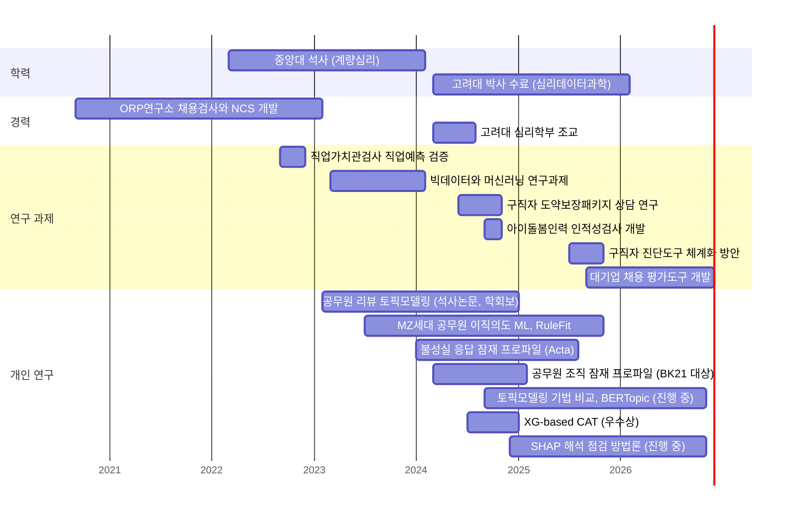

<h1 align="center">김진영 | Jin Young Kim</h1>

사람과 조직 데이터로 예측모형을 만들고, 그 예측이 무엇에 근거하는지 해석합니다.

  <code>머신러닝 예측모형</code> <code>설명가능 AI (SHAP, RuleFit)</code> <code>텍스트 분석과 LLM 활용</code> <code>불성실 응답 탐지</code> <code>웹 크롤링</code>

## What I Do

- **예측과 해석**: 머신러닝 예측모형 개발과 SHAP, RuleFit을 활용한 예측 근거 해석
- **텍스트 분석**: 토픽 모델링(STM, BERTopic)과 LLM을 활용한 텍스트 분석
- **측정과 데이터 품질**: 잠재 프로파일 분석, 문항반응이론을 활용한 측정 도구와 응답 품질 점검
- **자동화**: Python을 활용한 데이터 수집과 반복 업무 자동화

## Repositories

| 저장소 | 내용 | 방법 | 관련 성과 |
|---|---|---|---|
| [public-sector-topic-modeling](https://github.com/wls0kim/public-sector-topic-modeling) | 온라인 리뷰로 본 공무원의 공직 장단점 인식 | 구조적 토픽 모델링(STM), 공변량 분석 | 한국인사행정학회보(2024) 1저자, 석사학위논문 |
| [public-sector-turnover-ml](https://github.com/wls0kim/public-sector-turnover-ml) | MZ세대 공무원의 이직의도 예측 | caret 모형 비교, PyCaret, RuleFit | 사회과학연구논총(2025), 산조학회 우수 학술 논문상 |
| [public-sector-turnover-shap](https://github.com/wls0kim/public-sector-turnover-shap) | SHAP으로 본 이직의도의 심리적 메커니즘 | 랜덤 포레스트, SHAP | 한국심리측정평가학회(2025) 구두 발표 |
| [public-sector-lpa](https://github.com/wls0kim/public-sector-lpa) | 세대 구분을 넘어선 공무원 하위 집단 탐색 | 잠재 프로파일 분석(LPA) | BK21 아이디어 공모전 대상(2025) |
| [psychometrics-methods](https://github.com/wls0kim/psychometrics-methods) | 측정과 잠재변수 모형 실습 | 척도 CFA, ESEM 재현, LCA 추정 알고리즘 직접 구현 |  |
| [ml-practice](https://github.com/wls0kim/ml-practice) | 머신러닝 분류 모형 실습 | 모형 비교, 스태킹, 로지스틱 회귀, 랜덤 포레스트 PDP |  |
| [nlp-llm-practice](https://github.com/wls0kim/nlp-llm-practice) | 텍스트 분석과 LLM 활용 실습 | STM, LLM 합성 데이터, GPT-4o 멀티모달 분류 |  |

- 원자료는 비공개, 분석 코드와 연구 개요만 공개
- 외부 기관 과제는 코드 없이 개요만 정리

## Research Projects

외부 기관 연구 과제 (코드와 자료는 계약상 비공개)

| 기간 | 기관 | 과제 | 주요 방법 |
|---|---|---|---|
| 2025.09 ~ 2026.12 | 대기업 산학협력 | 신입 채용 평가도구 및 평가방법 설계 | 평가도구 설계 |
| 2025.07 ~ 2025.11 | 한국고용정보원 | 효과적인 온오프라인 취업 지원을 위한 구직자 진단도구 체계화 방안 | 고용행정 데이터 약 258만 명, 예측모형(LightGBM), SHAP, 해외 5개국 사례 분석 |
| 2024.09 ~ 2024.11 | 한국건강가정진흥원 | 아이돌봄인력 자격검증(인적성검사) 도구 개발 | 문항 분석, EFA, IRT, CFA |
| 2024.06 ~ 2024.11 | 한국고용정보원 | 구직자 도약보장패키지 개별상담 프로그램 효과 연구 | 상담일지 텍스트 분석, 빈도 분석, LLM 활용 핵심어 추출 |
| 2023.03 ~ 2024.02 | 중앙대학교 산학협력단 | 빅데이터와 머신러닝 연구과제 (연구보조원) | |
| 2022.09 ~ 2022.12 | 한국고용정보원 | 직업가치관검사 직업예측 타당성 검증 및 양식 개발 | 국내외 사례 검토, 직업추천 알고리즘 구현과 비교 |

## Side Project

| 기간 | 프로젝트 | 내용 |
|---|---|---|
| 2026.09 ~ | 채용공고 수집 자동화와 매칭 웹앱 | 여러 채용 사이트 공고를 정기 수집해 지원 자격과 접수 상태를 1차 판정, 공고와 경력을 항목별로 비교하는 매칭 웹앱 프로토타입 |

## Tech Stack

| 분야 | 도구 |
|---|---|
| 언어 |    |
| 분석 |     |
| 도구와 AI |     |

## Timeline

## Activity

<b>📄 Publications (4)</b>

| 연도 | 제목 | 학술지 | 저자 | 역할 |
|---|---|---|---|---|
| 2026 | Uncovering multidimensional patterns of insufficient effort responding: A latent profile analysis integrating survey data and cognitive task performance | *Acta Psychologica*, 262, 106162 | Park, G., **Kim, J.**, Jung, J. B., & Lee, T. | 2저자 (Formal analysis, Writing original draft) |
| 2025 | MZ세대 공무원의 이직의도 분석: RuleFit 기반 설명가능 인공지능(XAI)을 중심으로 | *사회과학연구논총*, 41(2), 195-241 | 신연우, **김진영**, 이태헌 | 2저자 (분석, 해석, 원고 작성 등 연구 실무 전반) |
| 2024 | 온라인 리뷰 텍스트 분석을 통한 공무원의 공직 장단점 인식 연구 | *한국인사행정학회보*, 23(4), 129-174 | **김진영**, 이솔빈, 이태헌, 장재윤 | 1저자 |
| 2024 | MZ세대 공무원의 고용 브랜드 요인 탐색 | 중앙대학교 석사학위논문 | **김진영** | 단독 |

<b>🎤 Conference Presentations (15)</b>

| 시기 | 학회 | 주제 | 저자 | 형식 | 수상 |
|---|---|---|---|---|---|
| 2026.10 | 한국심리측정평가학회 추계학술대회 | 온라인 직원 리뷰에 나타난 긍정·부정 직원경험 주제의 구조와 시간적 양상: BERTopic 기반 탐색 | 박경태, **김진영**, 장형빈, 이태헌 | 구두 | |
| 2026.07 | IMPS 2026 (International Meeting of the Psychometric Society) | Explainable AI Requires Explainable Data First | **김진영**, 이태헌 | 구두 | |
| 2026.05 | 한국심리측정평가학회 춘계학술대회 | BERTopic을 활용한 직원경험 요인 탐색 | 박경태, 김동훈, **김진영**, 이태헌 | 포스터 | 장려상 |
| 2025.11 | 한국심리측정평가학회 추계학술대회 | MZ세대 공무원의 이직의도 분석: RuleFit 기반 설명가능 인공지능(XAI)를 중심으로 | 신연우, **김진영**, 이태헌 | 구두 | |
| 2025.08 | 제79차 한국심리학회 연차학술대회 (측정평가) | MZ세대 공무원의 이직의도 분석: RuleFit 기반 설명가능 인공지능(XAI)을 중심으로 | **김진영**, 신진영, 이태헌 | 포스터 | |
| 2025.04 | 한국심리측정평가학회 춘계학술대회 | SHAP 기반 설명 가능한 AI로 들여다본 공무원 이직의도의 심리적 메커니즘 | **김진영**, 이태헌 | 구두 | |
| 2024.10 | 한국심리측정평가학회 추계학술대회 | XG-based CAT: CAT 문항 선정을 위한 부스팅 모델의 적용 가능성 탐색 | **김진영**, 신진영, 이태헌 | 포스터 | 우수상 |
| 2024.08 | 제78차 한국심리학회 연차학술대회 | 세대 간 차이의 한계를 넘어: 잠재 프로파일 분석을 통한 공무원 조직의 재해석 | **김진영**, 신진영, 이태헌 | 포스터 | |
| 2024.08 | 제78차 한국심리학회 연차학술대회 | Identifying Careless Responding through Latent Profile Analysis: Cognitive Profiles of Careless Responding | 박기룡, 장형빈, **김진영**, 신진영, 정재범, 이태헌 | 포스터 | 우수상 |
| 2024.04 | 한국심리측정평가학회 춘계학술대회 | M세대와 Z세대 공무원의 이직의도 예측 요인 비교: 머신러닝 기법의 적용 | **김진영**, 신진영, 이태헌 | 포스터 | |
| 2024.04 | 한국심리측정평가학회 춘계학술대회 | 심리학 연구에서의 응답 편향 식별: 잠재 클래스 분석을 중심으로 | 박기룡, 장형빈, **김진영**, 신진영, 이태헌 | 포스터 | |
| 2024.02 | 한국산업및조직심리학회 동계학술대회 | 머신러닝을 활용한 MZ세대 공무원의 이직의도 예측요인 분석 | **김진영**, 이태헌 | 포스터 | 우수 학술 논문상 |
| 2023.11 | 한국심리측정평가학회 추계학술대회 | 혼합연구방법론을 통한 MZ세대 공무원의 인식 파악: 토픽모델링, 설문조사를 중심으로 | **김진영**, 이솔빈, 이태헌 | 포스터 | 우수상 |
| 2023.08 | 제77차 한국심리학회 연차학술대회 (측정평가) | 공직사회의 세대별 고용브랜드 차이와 조직 혁신: 토픽모델링을 중심으로 | **김진영**, 이솔빈, 이태헌 | 포스터 | |
| 2018.08 | 한국심리학회 연차학술대회 | 브랜디드 콘텐츠 광고 유형이 구매 의도에 미치는 영향: 브랜드 태도의 매개효과 | Park, S. J., **김진영**, Park, E. | 포스터 | |

<b>🏆 Awards (6)</b>

| 시기 | 내용 |
|---|---|
| 2026.05 | 한국심리측정평가학회 춘계학술대회 포스터 발표 **장려상** (BERTopic을 활용한 직원경험 요인 탐색) |
| 2025.02 | 고려대학교 4단계 BK21 심리학교육연구단 아이디어 공모전 **대상** (팀장, 잠재 프로파일 분석을 통한 공무원 조직 재해석) |
| 2024.10 | 한국심리측정평가학회 추계학술대회 포스터 발표 **우수상** (XG-based CAT) |
| 2024.08 | 제78차 한국심리학회 연차학술대회 **우수상** (불성실 응답 잠재 프로파일) |
| 2024.02 | 한국산업및조직심리학회 동계학술대회 **우수 학술 논문상** (MZ세대 공무원 이직의도 예측요인 분석) |
| 2023.11 | 한국심리측정평가학회 추계학술대회 포스터 발표 **우수상** (토픽모델링과 설문을 결합한 MZ세대 공무원 인식 연구) |

<b>🏢 Work Experience</b>

| 기간 | 기관 | 내용 |
|---|---|---|
| 2024.03 ~ 2024.08 | 고려대학교 심리학부 | 조교 (고급심리통계, 심리통계) |
| 2020.09 ~ 2023.02 | ORP연구소 | 채용검사와 NCS 문항 개발, 적응형 인지검사 파일럿 데이터 분석, 채용전형 운영 지원 (인턴 입사 후 정규직 전환) |

